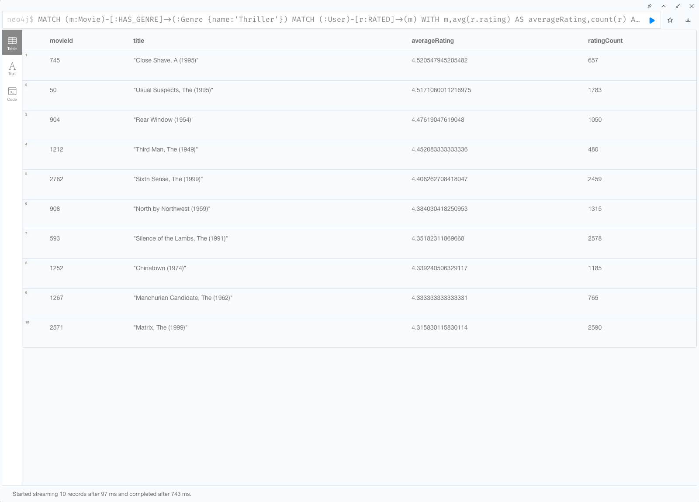
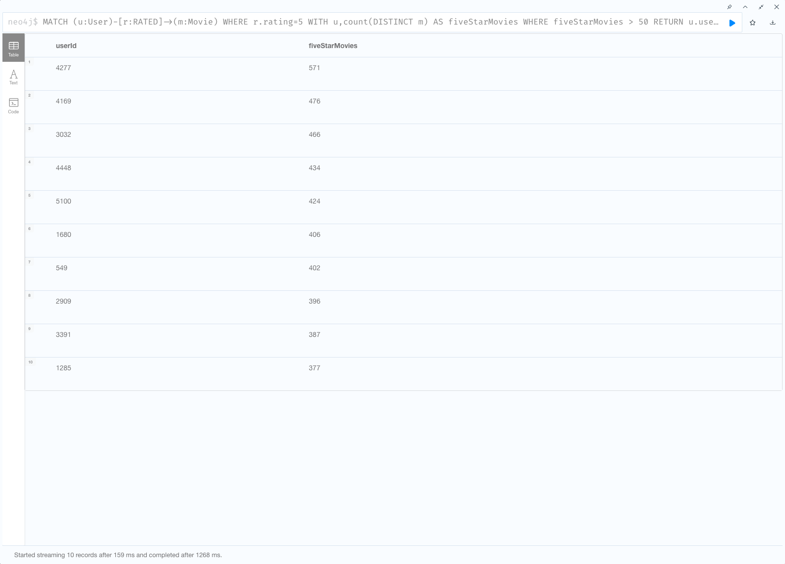
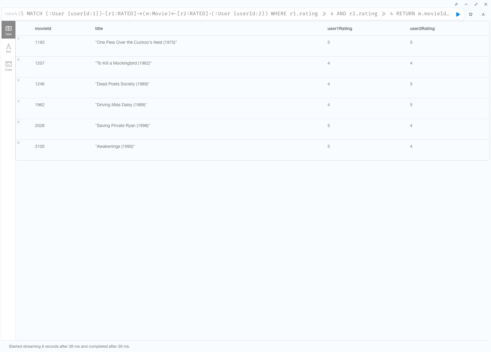
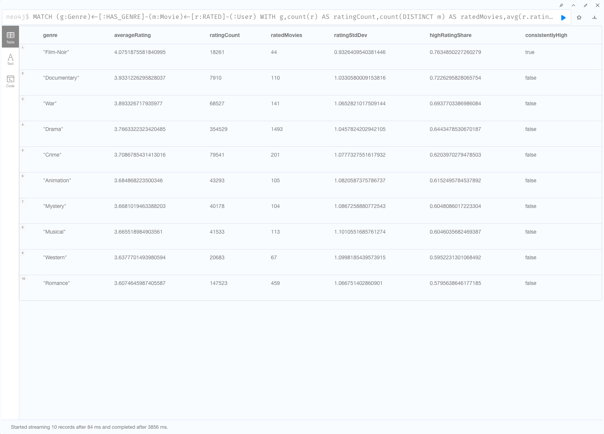
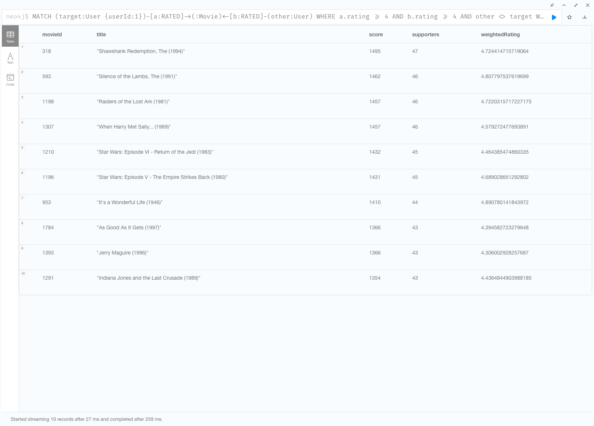
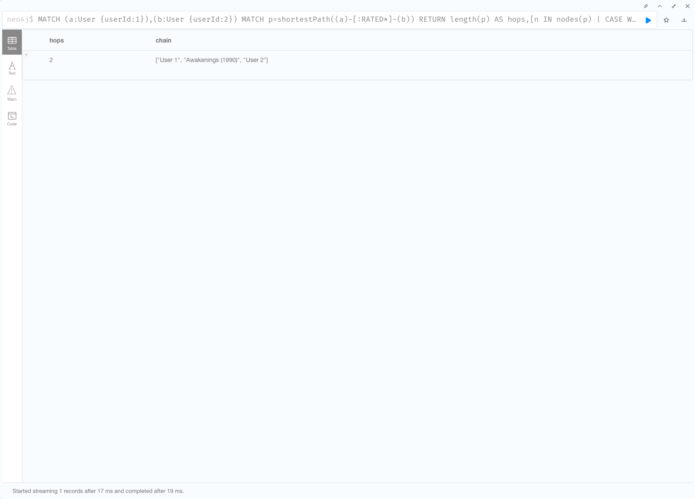
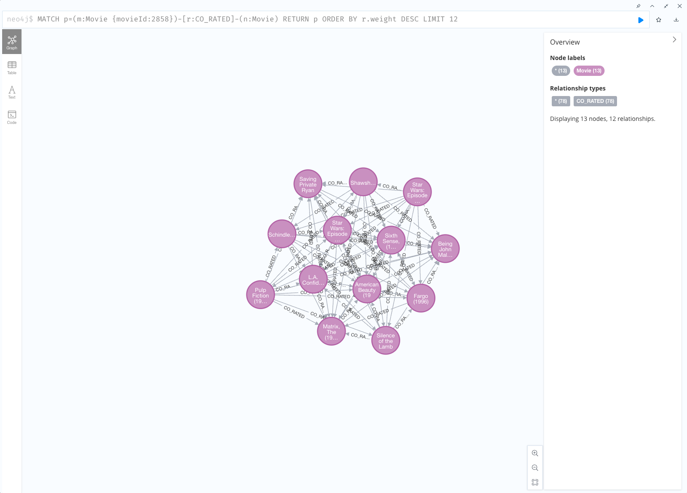
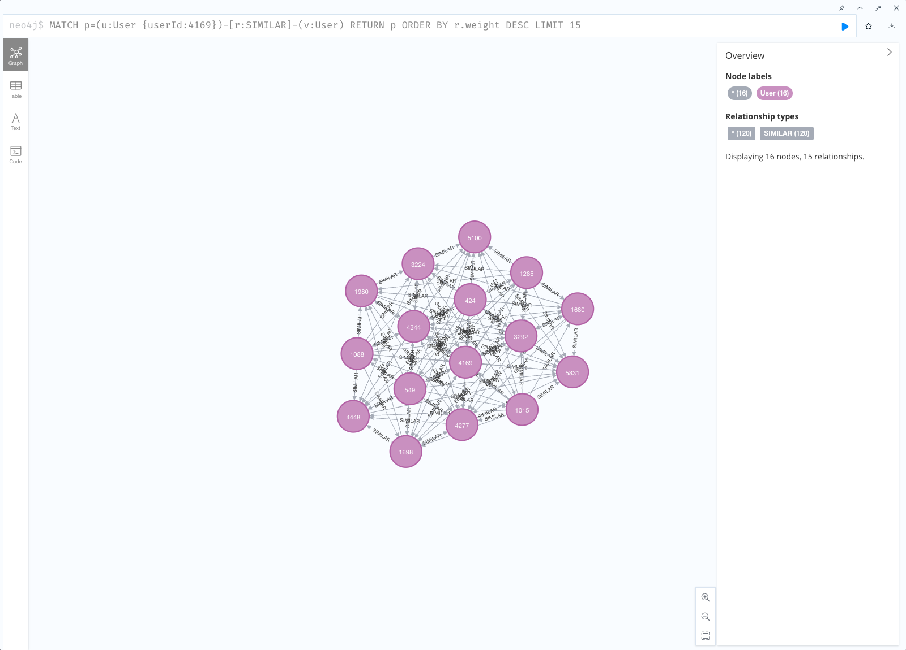

# Завдання 3. Граф знань для рекомендаційної системи

**Автор:** Володимир Шаповалов  
**Дисципліна:** NoSQL та векторні бази даних  
**Датасет:** MovieLens 1M, GroupLens Research  
**Дата фактичного виконання:** 18 жовтня 2026 року  
**Реалізовано:** усі обов'язкові частини та додатково PageRank, Louvain, Dijkstra.

## Результат та докази

Робота виконана локально в **реальній Neo4j**, не на згенерованих прикладах. Завантажено весь датасет, а не підмножину 200 000 оцінок.

| Перевірка | Фактичний результат |
|---|---:|
| User | 6 040 |
| Movie | 3 883 |
| Genre | 18 |
| RATED | 1 000 209 |
| HAS_GENRE | 6 408 |
| Повторний імпорт | ті самі кількості вузлів і ребер |
| Дублікати пар User–Movie | 0 |
| Некоректні RATED | 0 |
| Мінімум оцінок користувача | 20 |
| Фільми без оцінок | 177 |
| Індекси унікальних ключів | ONLINE |

У `results/*.json` збережені повні результати, текст кожного виконаного запиту, UTC-час запуску, тривалість та статистика Neo4j. `results/validation.json` містить незалежну звірку: **усі рядки Q1–Q5 збігаються з еквівалентними SQL-запитами у SQLite**. Для Q6 перевірено існування обох оцінок фільму-свідка та мінімальність довжини 2. Це перевірка правильності обчислень, а не порівняльний benchmark швидкодії.

Скриншоти нижче зроблені у Neo4j Browser. Для великих таблиць на скриншоті показано перші 10 рядків; у файлах запитів Q1, Q2 і Q4 **не обмежені десятьма результатами**.

## Файли проєкту

```text
shapovalov_nosql_3/
├── docker-compose.yml
├── .env.example
├── convert.py
├── run_queries.py
├── validate_results.py
├── prepare_similarity.py
├── requirements-gds.txt
├── import/                       # локально згенеровані CSV; не публікуються в Git
│   ├── movies.csv
│   ├── users.csv
│   ├── ratings.csv
│   ├── co_rated.csv              # додатковий етап
│   └── similar.csv               # додатковий етап
├── queries/
│   ├── part2_load.cypher
│   ├── part3.cypher
│   ├── part4_supernodes.cypher
│   ├── part5_gds.cypher
│   ├── part5_cleanup.cypher
│   ├── visualizations.cypher
│   ├── verify.cypher
│   └── recommendation.sql
├── results/                      # фактичні результати й перевірки
├── screenshots/
├── tests/test_convert.py
└── README.md
```

## Відтворення

### Середовище

Використано варіант **A — Docker**, без змін в AuraDB. Перевірені версії: Neo4j **5.18.1 Community**, APOC **5.18.0**, GDS **2.6.9**, Python **3.13**, NumPy **2.3.2**, SciPy **1.16.3**. Основна частина працює лише зі стандартною бібліотекою Python; NumPy/SciPy потрібні тільки для додаткової частини.

Compose використовує задану в умовах лінійку `neo4j:5.18-community`. Механізм `NEO4J_PLUGINS` завантажує сумісні плагіни під час запуску; потрібний доступ до інтернету. Образ і плагіни не закріплені SHA256-дайджестами: наведені версії — перевірений запуск, а не гарантія незмінності майбутнього завантаження. `queries/verify.cypher` показує реально встановлені версії.

### Основний запуск

Команди виконуються **з каталогу цього проєкту**. Docker Desktop має працювати; порти 7474/7687 мають бути вільними. Завантажте власну копію [MovieLens 1M](https://grouplens.org/datasets/movielens/1m/).

```bash
# Скрипт спочатку читає і виводить README з архіву.
# Файли читаються безпосередньо з ZIP, без розпакування .dat на диск.
python3 convert.py /absolute/path/to/ml-1m.zip > results/conversion.log

docker compose up -d --wait
python3 run_queries.py queries/part2_load.cypher
python3 run_queries.py queries/part3.cypher
python3 run_queries.py queries/part4_supernodes.cypher

# Повторний імпорт доводить ідемпотентність.
python3 run_queries.py queries/part2_load.cypher --prefix repeat_
python3 run_queries.py queries/verify.cypher
python3 -m unittest discover -s tests -v
```

Відкрийте **http://localhost:7474/browser/**, підключення `neo4j://localhost:7687`, користувач `neo4j`, локальний навчальний пароль `password123`. Обидва порти прив'язані **лише до 127.0.0.1**. Це не конфігурація для публічного сервера: простий пароль та широкі дозволи APOC/GDS допустимі тут лише для ізольованого навчального середовища.

Якщо змінюєте пароль, задайте його перед першим створенням бази:

```bash
export NEO4J_PASSWORD='your-local-password'
docker compose up -d --wait
```

Compose також читає `.env`, але `run_queries.py` читає **змінні процесу**, а не `.env`; для Python пароль потрібно експортувати. Зміна `NEO4J_AUTH` не змінює пароль уже створеної бази.

`run_queries.py` виконує по одному блоку `// @name ...` через HTTP API; тому APOC отримує коректний окремий запит, а не весь файл як одну строку. Скрипт зупиняється на помилці Cypher чи ненульових `failedBatches`/`failedOperations`. У Browser запускайте окремі оператори, а не весь файл одночасно.

### Додаткові алгоритми

```bash
python3 -m venv .venv
source .venv/bin/activate
python -m pip install -r requirements-gds.txt
python prepare_similarity.py
python run_queries.py queries/part5_gds.cypher
python run_queries.py queries/verify.cypher
python validate_results.py
```

Повна перевірка `validate_results.py` очікує також результати повторного імпорту та додаткової частини. До підготовки GDS запит `similarity_sample_check` закономірно порожній; це ще не перевірка ваг.

Для скриншотів графів виконайте два запити з `queries/visualizations.cypher` у Browser і виберіть **Graph**. За потреби задайте підпис користувача командою Browser `:style node.User { caption: "{userId}"; }`.

Проєкції GDS існують у пам'яті й зникають після перезапуску БД; матеріалізовані ребра та `User.community` зберігаються на диску. Після збереження результатів їх можна прибрати:

```bash
python run_queries.py queries/part5_cleanup.cypher
# Зупинка без видалення даних:
docker compose down
```

`part5_cleanup.cypher` видаляє лише дві проєкції, `CO_RATED`, `SIMILAR` та властивість `community`; `RATED` і `HAS_GENRE` залишаються. `docker compose down -v` видаляє дані — для звичайної зупинки його використовувати не треба.

## Частина 1. Проєктування схеми

```text
┌─────────────────────┐       RATED                 ┌───────────────────┐
│ User                │  ─────────────────────────► │ Movie             │
│ userId: Integer [U] │  rating: Integer (1..5)      │ movieId: Int [U]  │
│ gender: String      │  timestamp: Integer         │ title: String     │
│ age: Integer (код)  │  (Unix seconds)             │ year: Integer     │
│ occupation: Integer │                            └─────────┬─────────┘
└─────────────────────┘                                      │ HAS_GENRE
                                                             ▼
                                                   ┌───────────────────┐
                                                   │ Genre             │
                                                   │ name: String [U]  │
                                                   └───────────────────┘
[U] — uniqueness constraint з індексом.
```

**Які сутності стали вузлами, а які ребрами і чому?** Користувач, фільм і жанр мають незалежну ідентичність і повторно використовуються в багатьох зв'язках, тому це вузли. Оцінювання — факт зв'язку конкретного користувача з конкретним фільмом, тому `RATED`; жанрова належність — `HAS_GENRE`. Напрямок `User → Movie` означає «користувач оцінив фільм», а `Movie → Genre` — «фільм належить до жанру». У пошуку шляхів можна ігнорувати напрямок, не змінюючи модель зберігання. Демографічні коди залишені властивостями: окремі вузли віку або статі не потрібні для цих запитів і лише додали б низькокардинальні супервузли.

`age` — **код вікової групи**, а не точний вік: 1 — до 18, 18 — 18–24, 25 — 25–34, 35 — 35–44, 45 — 45–49, 50 — 50–55, 56 — 56+. `occupation` — код 0–20 зі словника оригінального README; це не числова шкала. Поштовий індекс не використовується й не імпортується. Назва з роком збережена дослівно, а `year` виділений для числових фільтрів. Бізнес-ідентифікатори `userId`/`movieId` не замінюються внутрішніми ID Neo4j.

**Оцінка — ребро чи окремий вузол?** Для цього датасету обрано ребро з властивостями: одна пара користувач–фільм має одну оцінку, і оцінювання не є самостійним об'єктом інших зв'язків. Це зменшує кількість вузлів приблизно на мільйон і дає прямий однокроковий перехід від користувача до фільму. Вузол `Rating` був би кращим, якби треба було прив'язувати текст рецензії, реакції, модератора, джерела або кілька історичних подій оцінювання. Недолік ребра: до нього не можна безпосередньо провести інше ребро; оновлення `rating` перезаписує попередній стан. Наш `MERGE` навмисно підтримує лише одну поточну оцінку на пару, а не журнал історії.

**Чому жанри — окремі вузли?** Спільний вузол жанру створює явний зв'язок фільмів, нормалізує назви та дозволяє почати запит з одного індексованого `Genre.name`. До жанру можна пізніше додати опис чи ієрархію. Масив `Movie.genres` простіший для показу картки й не створює хабів, тому теж має переваги; окремі вузли не є автоматично швидшими для кожної задачі. Для цього завдання вони корисні для навчання обходам і аналізу зв'язності, але ціною додаткових ребер та великих ступенів Drama/Comedy.

## Частина 2. Підготовка та завантаження

### Конвертація

`convert.py` читає лише чотири очікувані файли всередині наданого ZIP: `README`, `movies.dat`, `users.dat`, `ratings.dat`. Це замінює окрему ручну операцію розпакування: вихідні `.dat` не накопичуються в репозиторії. Рядки декодуються як **Latin-1**, розділяються за `::` і записуються стандартним `csv.writer` як **UTF-8 CSV з комою**. Назви з комами коректно беруться в лапки. Рік виділяється з кінцевих дужок, включно з реальною назвою `Associate, The (L'Associe)(1982)`, де немає пробілу перед роком.

Перевіряються дублікати ID та пар, наявність користувачів/фільмів для кожної оцінки, діапазон 1–5, невід'ємний timestamp, демографічні коди, структура рядків, рік і повтори жанрів фільму. Файли замінюються атомарно **кожен окремо**, не вся трійка разом: після помилки не слід імпортувати частково підготовлений набір. SHA256 джерела та результатів записаний у `results/conversion.json`. Тести перевіряють кодування і CSV-екранування, відсутній рік, дублікати, відсутній зовнішній ключ та недопустиму оцінку.

### Пояснення всіх блоків `part2_load.cypher`

| Блок | Що робить і чому |
|---|---|
| `unique_users` | Унікальність `User.userId`; створює backing RANGE index для пошуку користувача. |
| `unique_movies` | Унікальність `Movie.movieId`; індексований пошук фільму перед створенням оцінки. |
| `unique_genres` | Унікальність `Genre.name`; не дає створити два вузли Drama. |
| `await_indexes` | Чекає до 300 секунд, поки індекси стануть доступними, **до імпорту ребер**. |
| `load_users` | `LOAD CSV`, батчі по 1 000; `MERGE` лише за ID, інші властивості через `SET`, явне перетворення чисел. |
| `load_movies` | Батчі по 500; `MERGE` фільму, `UNWIND split(...,'\|')` жанрів, `MERGE` жанру й `HAS_GENRE`. |
| `load_ratings` | Батчі по 5 000; `MATCH` уже існуючих кінців за індексами, `MERGE RATED`, `SET rating/timestamp`. |
| `counts` | П'ять незалежних підзапитів рахують вузли та ребра без декартового множення результатів. |

`IF NOT EXISTS` дозволяє повторне створення constraints. `MERGE` лише за стабільним ключем, а не за всіма властивостями, запобігає дублюванню сутності при зміні її назви. APOC повертає статистику кожного імпорту; вона перевіряється runner-скриптом. Попередня перевірка orphan-оцінок важлива, оскільки `MATCH` не створює відсутній вузол і без контролю міг би тихо пропустити рядок.

**Чому `parallel:false`?** Імпорт жанрів повторно звертається до спільних вузлів. Навіть при наявних кінцевих вузлах паралельне створення ребер може конфліктувати за блокуваннями; `MATCH` не гарантує відсутності deadlock. Послідовні батчі обрані заради передбачуваності та ідемпотентності. `MERGE` у такому завантаженні не є універсальною гарантією унікальності пари за довільних конкурентних записів; для production потрібна окрема стратегія конкурентного доступу.

Початковий імпорт RATED: **201 батч**, 0 невдалих батчів, 0 невдалих операцій; спостережена тривалість **53,31 с**. Повторний — **43,46 с**, кількості не змінилися. Це два виміри конкретної локальної машини, а не обіцяна швидкість чи доказ переваги над SQL.

`verify.cypher` додатково перевіряє версії, ONLINE-індекси, відсутність дублів, допустимість оцінок, їх гістограму, мінімум оцінок користувача та 20 матеріалізованих ваг схожості. Розподіл оцінок: 1 → 56 174; 2 → 107 557; 3 → 261 197; 4 → 348 971; 5 → 226 310.

## Частина 3. Шість Cypher-запитів

Повний виконуваний код: [`queries/part3.cypher`](queries/part3.cypher).

### Q1. Thriller із середнім рейтингом > 4,0

Запит починає з жанру Thriller, знаходить пов'язані фільми та всі їх оцінки, групує за фільмом, обчислює `avg`/`count`, і лише потім застосовує `averageRating > 4.0`. Фільтр до агрегації за окремою високою оцінкою дав би неправильне середнє. Фільми без оцінок не мають визначеного середнього й не потрапляють у результат.

**Результат: 52 фільми.** Перший — `Close Shave, A (1995)`, 4,52055, 657 оцінок; другий — `Usual Suspects, The (1995)`, 4,51711, 1 783 оцінки. Жанри взяті саме з датасету, навіть якщо категоризація окремого фільму неочевидна. Мінімальний розмір вибірки умовою не заданий, тому низькокількісні результати не приховані; `ratingCount` дозволяє оцінити їхню надійність.



### Q2. Користувачі, які поставили 5 понад 50 фільмам

Спочатку відбираються ребра `rating=5`, потім рахується `count(DISTINCT m)` для кожного користувача. `>50` означає щонайменше 51 фільм, а не 50. `DISTINCT` виражає саме кількість різних фільмів.

**Результат: 1 390 користувачів.** User 4277 — 571 фільм, User 4169 — 476. Велика кількість п'ятірок може бути наслідком активності чи особистої шкали оцінювання, а не об'єктивно «кращого смаку».



### Q3. Спільні улюблені фільми користувачів 1 і 2

Шаблон `User 1 → Movie ← User 2` перевіряє оцінки **обох** користувачів на тому самому фільмі; обидва рейтинги мають бути ≥4. Це перетин множин улюблених фільмів, не об'єднання й не середній рейтинг.

**Результат: 6 фільмів**, зокрема `One Flew Over the Cuckoo's Nest (1975)` — 5/5 та `To Kill a Mockingbird (1962)` — 4/4.



### Q4. Жанри з високими оцінками

Запит групує оцінки за жанром, повертає середнє, кількість оцінок, кількість оцінених фільмів, стандартне відхилення та частку оцінок 4–5. «Стабільно високі» тут має явне **операційне визначення**: середнє ≥4, щонайменше 1 000 оцінок і щонайменше 70% високих оцінок. Це не статистичний доказ часової стабільності або того, що кожен фільм жанру хороший. Виведені всі 18 жанрів із прапорцем, щоб не приховувати негативні результати.

**Єдиний жанр, що проходить усі пороги, — Film-Noir:** середнє 4,07519; 18 261 оцінка; 44 оцінених фільми; стандартне відхилення 0,93264; 76,35% оцінок 4–5. Documentary має середнє 3,93312 і тому не проходить перший поріг. Середнє зважене кількістю оцінок, а не «середнє середніх фільмів». Одна оцінка багатожанрового фільму входить до кожного його жанру; сума жанрових кількостей перевищує 1 000 209.



### Q5. «Користувачі зі схожими смаками також дивилися»

Ціль — User 1. Схожість двох користувачів визначена кількістю фільмів, яким **обидва** поставили ≥4. Беруться сусіди з ≥3 спільними вподобаннями, top-50 за їх кількістю, при рівності — за userId. Далі відбираються фільми з високою оцінкою сусідів та **без будь-якої оцінки цільового користувача**, включно з низькою. Кандидат має отримати підтримку щонайменше двох різних сусідів.

`score = Σ sharedLikes` підсумовує ваги підтримки; `supporters` — кількість сусідів, а `weightedRating = Σ(sharedLikes × rating) / ΣsharedLikes`. Повертається top-10 за score, supporters, weightedRating та movieId для стабільного порядку. `LIMIT 50` стоїть **після підрахунку сусідів**, а `LIMIT 10` — після ранжування кандидатів.

Перші рекомендації:

| Фільм | Score | Сусідів | Зважений рейтинг |
|---|---:|---:|---:|
| Shawshank Redemption, The (1994) | 1495 | 47 | 4,7244 |
| Silence of the Lambs, The (1991) | 1462 | 46 | 4,8078 |
| Raiders of the Lost Ark (1981) | 1457 | 46 | 4.7220 |

**Обмеження:** MovieLens фіксує оцінки, а не повну історію переглядів. Тому «ще не дивився» технічно означає «ще не оцінив у наданих даних». Лічильник спільних вподобань має bias до активних користувачів і популярних фільмів; це навчальний baseline, не доведено якісний персональний рушій. Немає train/test-поділу та оцінки Precision@K/Recall@K, тому якість рекомендацій на нових даних не заявляється.



### Q6. Найкоротший ланцюжок між користувачами

`shortestPath((a)-[:RATED*]-(b))` знаходить шлях з мінімальною кількістю ребер між User 1 і User 2. Напрямок ігнорується навмисно: інакше від фільму немає вихідного `RATED` назад до користувача. Дозволено **лише RATED**, а не HAS_GENRE чи допоміжний SIMILAR. Високий рейтинг тут не потрібний: завдання стосується самого зв'язку через оцінений фільм.

У збереженому результаті: **User 1 → Awakenings (1990) → User 2**, довжина **2**. Може існувати кілька однаково коротких шляхів: Browser або інший запуск має право повернути інший спільний фільм. Мінімальність доведена також структурно: у двочастковому графі немає прямого ребра User–User, а спільний фільм дає шлях з двох ребер.

- **1 хоп** — один перехід по ребру RATED.
- **2 хопи:** `U₁–M₁–U₂` — обидва оцінили той самий фільм.
- **4 хопи:** `U₁–M₁–Uₓ–M₂–U₂` — один проміжний користувач і два фільми.
- **6 хопів:** `U₁–M₁–Uₓ–M₂–Uᵧ–M₃–U₂` — два проміжні користувачі і три фільми.

Між різними користувачами довжини тут парні. Це не дружба і не «знайомства»: зв'язок означає лише спільне оцінювання.



## Частина 4. Супервузли

Код: [`queries/part4_supernodes.cypher`](queries/part4_supernodes.cypher). Ступінь рахує обидва напрямки **тільки базових RATED і HAS_GENRE**, щоб додаткові ребра GDS не спотворювали аналіз.

### Пояснення запитів

- `degree_distribution`: мінімум, середнє, медіана, p95, p99 та максимум **окремо за label**. Порівнювати жанр з користувачем одним універсальним порогом некоректно.
- `top_degrees`: 20 найбільших ступенів у базовому графі з назвою та бізнес-ID.
- `genre_degrees`: кількість фільмів у кожного жанру, що дозволяє побачити низькокардинальні хаби.
- `top_users`: 10 найбільш активних користувачів за кількістю оцінок.
- `movie_coverage`: усі 3 883 фільми, з них 177 не мають оцінок; вони не зникли під час імпорту.

### Які вузли виявились супервузлами?

| Label | Медіана ступеня | p95 | p99 | Максимум |
|---|---:|---:|---:|---:|
| User | 96 | 556 | 906,66 | 2314 |
| Movie | 111 | 1035,90 | 1759,58 | 3430 |
| Genre | 231 | 1260,45 | 1534,49 | 1603 |

| Вузол | Ступінь | Що саме пораховано |
|---|---:|---|
| American Beauty (1999), Movie 2858 | **3430** | 3428 оцінок + 2 жанри |
| Star Wars: Episode IV (1977), Movie 260 | **2995** | 2991 оцінка + 4 жанри |
| User 4169 | **2314** | оцінені фільми |
| User 1680 | **1850** | оцінені фільми |
| Genre Drama | **1603** | фільми |
| Genre Comedy | **1200** | фільми |

American Beauty і User 4169 явно перевищують p99 свого типу. Drama також вище p99 жанрів. Comedy нижче p95 жанрів, проте для виконання конкретного обходу все одно є великим хабом на 1200 фільмів. Тому «супервузол» — не окремий label Neo4j і не магічна межа, а характеристика ступеня **та впливу на запит**. При всього 18 жанрах їх висока зв'язність структурно очікувана.

### Чому ті самі індекси не вирішують проблему?

Індекс прискорює **знаходження початкового вузла**, але після його знаходження рушій усе одно має прочитати потрібні ребра й сусідів. Перехід через Drama розкриває 1603 фільми, а потім потенційно сотні тисяч оцінок. Для створення всіх пар користувачів популярний фільм із `k` високими оцінками породжує до `k(k−1)/2` пар. Це множення проміжних результатів, витрати CPU, пам'яті та агрегації; індекс на movieId їх не прибирає. Не кожен запит із супервузлом обов'язково повільний, але повний обхід його великого околу за інших рівних умов виконує більше роботи.

### Конкретна стратегія

Насамперед треба **обмежити розгортання околу**: починати з конкретного користувача, застосовувати семантично потрібні фільтри раніше та не проходити через жанр для collaborative filtering. Q5 взагалі не зачіпає Genre. Для повторюваних рекомендацій доцільно матеріалізувати нормалізовану top-k схожість **для кожного користувача**, з версією/часом оновлення, замість нескінченного повторного перебору спільних фільмів.

Для жанрових хабів конкретний варіант шардінгу — `Genre → GenreBucket {decade} ← Movie`: якщо запит завжди задає десятиліття, він розкриває лише потрібний bucket. **Без такого фільтра** треба обійти всі buckets, і загальний обсяг роботи не зменшиться. Для простого показу жанру можна денормалізувати масив у Movie, а для Q4 — підтримувати агрегати. Це свідомий trade-off швидкого читання проти дублювання, інвалідації кешу та складнішого оновлення; розбиття жанрів чи масив самі по собі не прискорять будь-який запит. Відповідність термінам конкретної лекції не заявляється: матеріали лекції до роботи не додані.

## Частина 5. Додаткові алгоритми GDS

**Усі три алгоритми реально запущені**, а не лише наведені як шаблон. Код — [`queries/part5_gds.cypher`](queries/part5_gds.cypher).

### Побудова графів і пояснення кроків

Двокроковий Cypher self-join на повному датасеті створює дуже багато проміжних рядків. Тут **обчислення ваг**, а не алгоритми GDS, винесено у `prepare_similarity.py`: розріджена цілочисельна матриця `B[u,m]=1`, якщо rating ≥4. Тоді `BᵀB` точно рахує спільних користувачів для пар фільмів, а `BBᵀ` — спільні фільми для пар користувачів. Int64 уникає переповнення малих цілих типів. Діагональ відкинута, береться тільки верхній трикутник, тобто одна пара без дубля зворотного напрямку.

Це еквівалентне агрегуванню наведених у завданні шаблонів, але з явним порядком при однакових вагах: `weight DESC, source ID, target ID`. Для фільмів залишаються лише пари, у яких **кожен фільм має >20 усіх оцінок**. Вибираються 50 000 найсильніших пар кожного типу. Перевірено 20 ваг SIMILAR незалежним Cypher-перетином на вихідних RATED; це вибіркова перевірка ваг, не перевірка всіх 100 000 похідних ребер.

| Етап | Пояснення |
|---|---|
| `drop_old_*_projection` | Прибирає старі іменовані GDS-проєкції для повторного запуску. |
| `clear_derived_edges` | Видаляє попередні CO_RATED/SIMILAR у цій окремій навчальній базі, не базові оцінки. |
| `load_co_rated`, `load_similarity` | Батчами по 1000 матеріалізує точні ваги з локальних CSV. SIMILAR також має `distance=1/weight`. |
| `project_movies`, `project_users` | Створює окремі графи в пам'яті GDS; орієнтація UNDIRECTED, потрібні числові властивості включені явно. |
| `pagerank` | Зважений PageRank, до 100 ітерацій, tolerance 10⁻⁶, concurrency 1; top-10. |
| `louvain` | Зважений Louvain із записом `User.community`; повертає modularity і число спільнот. |
| `community_sizes` | 10 найбільших спільнот, включно з одноелементними, якщо вони потрапили у top-10. |
| `community_genres` | Для **кожної** спільноти top-3 жанри за кількістю оцінок ≥4 її користувачів. |
| `isolated_users` | Рахує користувачів без SIMILAR: контроль викривлень через обрізання графа. |
| `dijkstra_pairs` | 4 показові та 100 детерміновано розподілених пар; зберігає також недосяжні пари як null, не приховує їх. |

Позитивних кандидатних пар після фільтрів: **3 481 384** для фільмів і **16 205 371** для користувачів. Після top-50 000 мінімальні збережені ваги — відповідно **157** і **117**. Проєкції містять 3883/6040 вузлів та по **100 000** проєктованих зв'язків: одне збережене ребро враховується у двох напрямках для UNDIRECTED.

Зменшення фінального `LIMIT` **після** `GROUP BY/count/ORDER BY` не прибирає попереднього перебору всіх пар. Для суттєвого зменшення цієї роботи потрібні ранні фільтри, інший алгоритм підрахунку або зміна моделі. Матриці також споживають пам'ять; цей спосіб не є безкоштовним чи необмежено масштабованим.

### 5.1. PageRank

| Фільм | PageRank | Кількість усіх оцінок |
|---|---:|---:|
| American Beauty (1999) | 9,97270 | 3428 |
| Star Wars: Episode IV (1977) | 9,43134 | 2991 |
| Star Wars: Episode V (1980) | 9,38942 | 2990 |
| Raiders of the Lost Ark (1981) | 8,27814 | 2514 |
| Fargo (1996) | 7,29191 | 2513 |

Високий PageRank означає **центральність у мережі спільних високих оцінок**, особливо зв'язки з іншими центральними фільмами. Це не просто кількість оцінок і не середній рейтинг: враховується структура та вага сусідства. Наприклад, Fargo вище за Matrix у PageRank, хоча має менше всіх оцінок (2513 проти 2590). Популярність усе одно сильно впливає на кількість спільних прихильників, тому алгоритм не «усуває popularity bias». Оцінки GDS у цьому запуску не нормовані до суми 1. Top-50 000 та ізольовані фільми змінюють центральності; результат характеризує саме цю обрізану проєкцію.



Скриншот — **малий окіл**, вибраний 12 найсильнішими зв'язками American Beauty, не повний граф з 3883 фільмів. Browser додатково показує наявні зв'язки між поверненими вузлами; тому число зв'язків у легенді може перевищувати число шляхів у результаті. Напрямок збереженого ребра задається порядком ID, а GDS трактує його як ненапрямлене.

### 5.2. Louvain

**4826 спільнот**, modularity **0,158615**, 1 рівень; записано 6040 значень `community`. Найважливіша перевірка: **4823 користувачі ізольовані** у графі SIMILAR, тобто приблизно 79,85% усіх користувачів. Вони утворюють 4823 одноелементні спільноти. Решта 1217 користувачів розподілені між трьома великими спільнотами:

| Community ID у цьому запуску | Користувачів |
|---|---:|
| 4276 | 792 |
| 1736 | 235 |
| 1273 | 190 |
| 0 | 1 |
| 1 | 1 |
| 2 | 1 |
| 3 | 1 |
| 4 | 1 |
| 5 | 1 |
| 6 | 1 |

ID спільнот — технічні мітки, а не номери жанрів; при іншому запуску можуть відрізнятися.

Для спільноти 4276 top-3: **Drama 68 786**, **Comedy 55 595**, **Action 37 508** високих оцінок. Для 1736: **Comedy 28 908**, **Drama 26 587**, **Action 23 014**. Для 1273: **Drama 31 299**, **Comedy 22 663**, **Thriller 10 859**. Повний результат для всіх 4826 спільнот — `results/community_genres.json`.

**Чи є це «любителями бойовиків» та «цінителями артхаусу»?** Ні, таких сильних висновків результати не дають. У найбільших групах домінують ті самі масові жанри, лише в іншому порядку; modularity 0,1586 не свідчить про дуже чітке розділення. Top-50 000 глобально віддає перевагу надзвичайно активним користувачам. Більшість singleton-груп — наслідок обрізання графа, не доказ унікального смаку кожного користувача.

**Як перевірено?** Зіставлено розміри груп, кількість ізольованих користувачів і top-3 жанри на вихідних високих оцінках. Це описова перевірка, не незалежна «істинна» розмітка. Для змістовнішого висновку треба порівняти нормовані частки жанрів із загальним фоном, врахувати активність користувачів, спробувати Jaccard/cosine і top-k **на кожного користувача**, перевірити стабільність кластерів при зміні параметрів. Жанрові лічильники не є кількістю унікальних фільмів: кілька користувачів можуть високо оцінити один фільм.



Це вибірка 15 найсильніших зв'язків користувача, а не повна проєкція і **не візуалізація кольорів спільнот Louvain**. Розбиття підтверджується таблицями GDS; колір вузлів Browser позначає label User.

### 5.3. Dijkstra

Вага `SIMILAR.weight` — сила схожості, а Дейкстра мінімізує вартість. Використати її напряму означало б віддавати перевагу **слабшим** зв'язкам. Тому задано додатну вартість **distance = 1 / weight**: більша схожість — дешевший перехід. Проєкція містить обидві властивості: Louvain використовує weight, Dijkstra — distance.

| Пара | Маршрут | Хопів SIMILAR | Вартість |
|---|---|---:|---:|
| 1 → 2 | недосяжна | — | — |
| 4169 → 1680 | 4169 → 1680 | 1 | 0,00205761 |
| 4277 → 1941 | 4277 → 1941 | 1 | 0,00289855 |
| 1181 → 889 | 1181 → 4277 → 889 | 2 | 0,00872799 |

Перші дві досяжні пари не мають проміжних користувачів; остання має одного. Результат 1→2 не суперечить Q6: там використовуються всі RATED, а тут — тільки 50 000 відібраних SIMILAR.

Додатково перевірено **100 різних пар**, детерміновано розподілених по ID формулами у запиті. Це **не випадкова репрезентативна вибірка**. Досяжні лише **2/100**, обидва маршрути мають 2 хопи: умовне середнє **2,0 серед досяжних пар**. Серед трьох досяжних показових пар вище — 1,33 хопа; їх не слід змішувати з діагностичною сотнею. Недосяжним парам не приписується довжина 0 і вони не зникають із знаменника звіту про покриття.

**Наскільки це «тісний світ» і чи підтверджені шість рукостискань?** В обрізаному графі активне ядро має короткі маршрути, але більшість користувачів ізольована. Загальну середню скінченну відстань для всіх пар цієї незв'язної мережі не визначено; перевірена вибірка не доводить small-world для всього MovieLens. Крім того, Dijkstra мінімізує суму вартостей, а **не кількість хопів**; його оптимальний зважений маршрут може мати більше ребер за найкоротший незважений. Для перевірки «шести рукостискань» потрібні достатньо репрезентативні пари, незважені shortest paths і явна статистика компонентів. Тут гіпотеза **не підтверджена**.

## Частина 6. Аналіз та висновки

### 1. Граф vs SQL

**Жоден із шести запитів не є принципово неможливим у SQL.** Q1, Q2, Q4 природно виражаються JOIN/GROUP BY/HAVING, Q3 — self-join таблиці оцінок. Q5 потребує кількох JOIN, CTE, агрегації та anti-join (`NOT EXISTS`), але теж цілком доступний. Графова нотація краще показує структуру `User → Movie ← User → Movie`, тоді як SQL явно описує з'єднання таблиць. Для Q6 з невідомою наперед довжиною стандартного JOIN недостатньо: потрібна рекурсія, контроль циклів і вибір мінімальної довжини, наприклад recursive CTE у PostgreSQL. Це складніше за один `shortestPath`, але не неможливо. Перевага графа тут — виразність та модель обходів, а не доведена універсальна перевага часу виконання.

Реляційна схема для порівняння: `users(userId PK, ...)`, `movies(movieId PK, ...)`, `ratings(userId FK, movieId FK, rating, timestamp, PK(userId,movieId))`, `genres(name PK)`, `movie_genres(movieId FK, genre FK, PK(movieId,genre))`; додатковий індекс `ratings(movieId)` підтримує зворотні пошуки. Конкретний еквівалент Q5 нижче **реально виконано в незалежній SQLite-перевірці**, результати збігаються:

```sql
WITH neighbours AS (
  SELECT b.userId, COUNT(*) AS sharedLikes
  FROM ratings a JOIN ratings b ON a.movieId=b.movieId
  WHERE a.userId=1 AND b.userId<>1 AND a.rating>=4 AND b.rating>=4
  GROUP BY b.userId
  HAVING COUNT(*)>=3
  ORDER BY sharedLikes DESC,b.userId
  LIMIT 50
)
SELECT m.movieId,m.title,SUM(n.sharedLikes) AS score,
       COUNT(DISTINCT n.userId) AS supporters,
       SUM(1.0*n.sharedLikes*r.rating)/SUM(n.sharedLikes) AS weightedRating
FROM neighbours n
JOIN ratings r ON r.userId=n.userId
JOIN movies m ON m.movieId=r.movieId
WHERE r.rating>=4
  AND NOT EXISTS (
    SELECT 1 FROM ratings seen WHERE seen.userId=1 AND seen.movieId=m.movieId
  )
GROUP BY m.movieId,m.title
HAVING COUNT(DISTINCT n.userId)>=2
ORDER BY score DESC,supporters DESC,weightedRating DESC,m.movieId
LIMIT 10;
```

### 2. Де граф програє?

Для повного сканування мільйона оцінок, звітів за віковими групами/часом, histogram рейтингу, регулярного CSV-експорту та табличної BI-аналітики реляційна модель часто простіша й природніша. Такі операції мало використовують переваги локальних обходів: усе одно потрібно агрегувати велику частку даних. Таблиця ratings має компактну однорідну структуру, SQL-системи мають зрілі інструменти звітності та оптимізації агрегацій. У графі додаються зберігання зв'язків, керування проєкціями GDS і небезпека розмноження рядків через супервузли. У цій роботі SQL і Cypher перевірені на однакову семантику, але окремого контрольованого performance benchmark немає: стверджувати конкретне прискорення однієї БД над іншою не можна.

### 3. Покращення схеми для конкретних запитів

**Q1:** додати до Movie матеріалізовані `ratingSum`, `ratingCount`, `averageRating` і індекс на `averageRating`, після чого комбінувати жанровий фільтр із відбором середнього >4 без повторного читання всіх RATED кожного кандидата. Для зміни оцінки треба віднімати старе значення і додавати нове; лічильник не повинен збільшуватися при повторному MERGE. Це прискорює читання, але ускладнює транзакційне оновлення й виправлення накопичених розбіжностей. Точний план слід перевіряти PROFILE: наявність індексу сама по собі не гарантує вибір найкращого старту.

**Q5:** підтримувати окремі top-k зв'язки нормованої схожості користувачів, наприклад `SIMILAR {similarity, computedAt, version}`, і починати рекомендацію з них. Це прибирає повторне знаходження схожих користувачів через великий self-join, але змінює свіжість і, за нормалізованою метрикою, саму семантику поточного baseline. Поточний дослід з глобальним top-50 000 показав, чому потрібне саме локальне top-k, а не відсікання всіх слабших користувачів. Також можна окремо підтримувати `LIKED` для rating≥4, зберігши RATED як джерело істини; при зміні оцінки через поріг ребро треба синхронно додавати/видаляти.

**Q4:** агрегати `ratingSum`, `ratingCount`, `highRatingCount` для Genre дозволять швидко показувати звіт, але одна зміна оцінки багатожанрового фільму оновлює кілька агрегатів. Для стандартного відхилення потрібні додаткові достатні статистики або перерахунок. Жанрові buckets доцільні лише разом із фільтром періоду/десятиліття; вони не замінюють агрегати для глобального звіту.

### Підсумок

Граф добре описує рекомендації як ланцюжки зв'язків, дозволяє стисло знаходити шляхи та використовувати GDS. Реляційна модель лишається сильною для масової табличної аналітики; фіксовані обходи можна виразити SQL без втрати змісту. Найважливіший практичний урок — **перевіряти не лише синтаксис, а й семантику та покриття**: відсутність оцінки не дорівнює відсутності перегляду, ступінь не дорівнює PageRank, similarity не дорівнює distance, а успішний Louvain на сильно обрізаному графі не означає якісну сегментацію всіх користувачів.

## Дані, ліцензія і архів

Оригінальний README MovieLens прочитаний до завантаження; його текст збережений у `results/conversion.log`. GroupLens вимагає атрибуції та окремого дозволу на перерозповсюдження даних. Тому **публічний Git-репозиторій містить код, звіт, скриншоти й результати аналізу, але не `.dat`, `ml-1m.zip` або повні CSV датасету**. Каталог `import/` у Git містить `.gitkeep`; усі CSV відтворюються командами вище з власної копії джерела.

Локальний архів `shapovalov_nosql_3.zip` повертає автору роботу разом із CSV, перетвореними з наданого ним архіву, для власного відтворення. **Він не публікується в GitHub.** Перед передачею повного набору даних третім особам слід врахувати умови GroupLens; альтернативою для здачі без даних є ZIP вихідного коду з GitHub і самостійне завантаження MovieLens перевіряльником. Секрети, `.env`, `.git`, кеші Python, віртуальне середовище та Docker volumes до архіву не включаються.

## Джерела

- [MovieLens 1M, GroupLens Research](https://grouplens.org/datasets/movielens/1m/); технічний формат, словники та usage license — `ml-1m/README` у вихідному архіві.
- F. Maxwell Harper and Joseph A. Konstan. 2015. *The MovieLens Datasets: History and Context*. ACM TiiS 5(4), Article 19. [DOI: 10.1145/2827872](https://doi.org/10.1145/2827872).
- [APOC periodic iterate](https://neo4j.com/docs/apoc/current/overview/apoc.periodic/apoc.periodic.iterate/).
- [GDS PageRank](https://neo4j.com/docs/graph-data-science/current/algorithms/page-rank/).
- [GDS Louvain](https://neo4j.com/docs/graph-data-science/current/algorithms/louvain/).
- [GDS Dijkstra Source-Target](https://neo4j.com/docs/graph-data-science/current/algorithms/dijkstra-source-target/).

Онлайн-документація `current` може описувати новіші версії API; факт сумісності наведеного коду підтверджений саме локальними версіями з `results/versions.json`.
